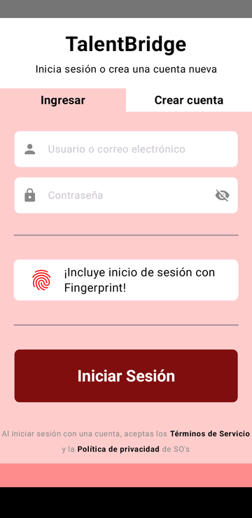
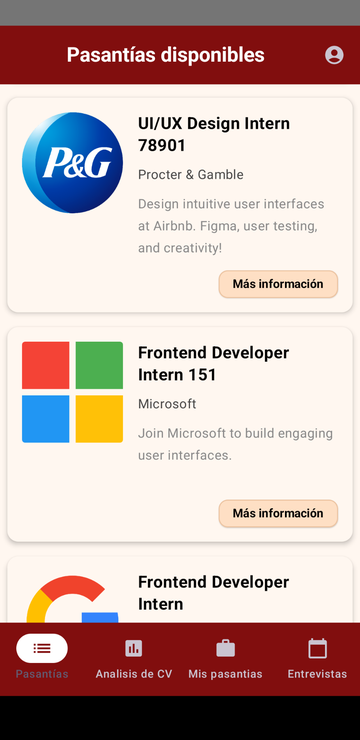
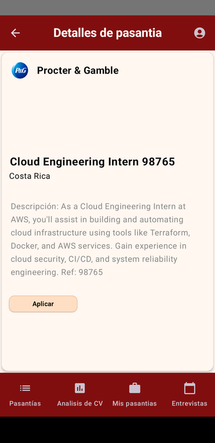
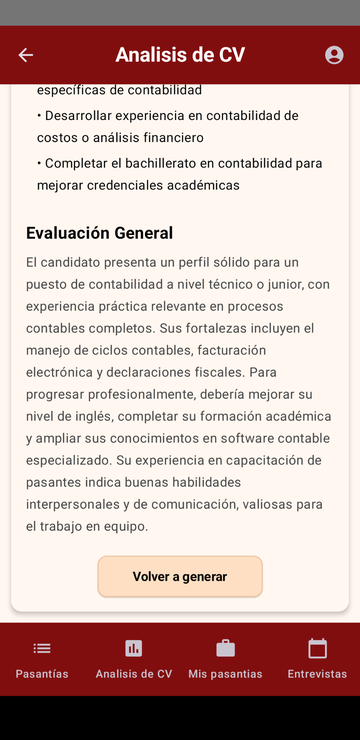
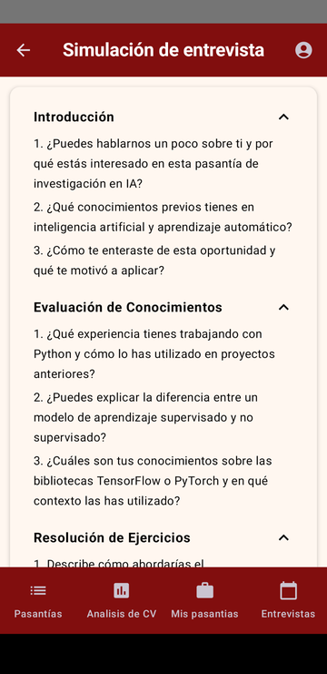
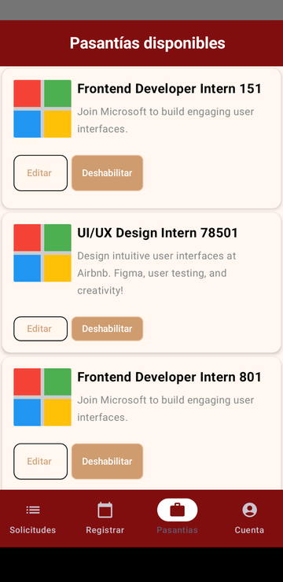
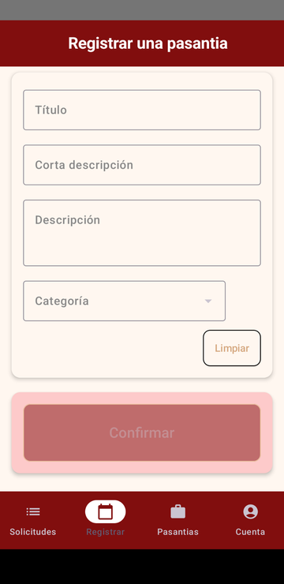
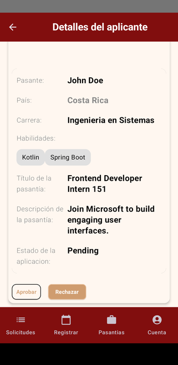

# TalentBridge

An Android app that connects university students with companies offering internships, with AI features that
help students prepare: it analyzes their CV and simulates an interview for the internship they applied to.

Built as a team project for the Mobile Platforms Design and Programming course at Universidad Nacional de
Costa Rica (2025). In the codebase the project still uses its original working name, *OportunIA*.

## Screenshots

| Sign in | Internships | Internship detail | CV analysis |
|---|---|---|---|
|  |  |  |  |

| Interview simulation | Company: internships | Company: new internship | Company: applicant |
|---|---|---|---|
|  |  |  |  |

All data shown is sample data.

## What it does

**For students**

- Browse internships, apply, and follow the status of each application.
- Upload a CV (PDF) and get an AI analysis: strengths, weaknesses, areas to improve and an overall evaluation.
- Practice with an AI-generated interview tailored to the internship: introduction, knowledge questions,
  exercises and closing questions.
- Sign in with email and password or with a fingerprint.

**For companies**

- Publish, edit and disable internships.
- Review applicants and approve or reject each application.
- Manage the company profile.

## How it is built

```
android/   Android app      Kotlin, Jetpack Compose, Hilt, Retrofit, DataStore
backend/   REST API         Kotlin, Spring Boot 3, Spring Security (JWT), Spring Data JPA, Spring AI
```

- **Android app.** Organized in `data`, `domain` and `presentation` layers. The UI is Jetpack Compose with
  Material 3; Hilt provides dependency injection and Retrofit talks to the API.
- **Backend.** A stateless REST API secured with JWT. Data is stored in PostgreSQL through Spring Data JPA.
- **AI.** Spring AI calls OpenAI and Anthropic models. The CV is read from the uploaded PDF and sent with a
  prompt that returns a structured analysis; interview questions are generated from the internship description.
- **Images.** Profile pictures and logos are stored in Cloudinary.
- **Deployment.** The API ships with a Dockerfile and was deployed to Heroku with a PostgreSQL database.

## Running it

### Backend

Requirements: JDK 17 and a PostgreSQL database.

```bash
cd backend
cp .env.example .env        # then fill in your own values
set -a && source .env && set +a
./gradlew bootRun --args='--spring.profiles.active=dev'
```

`.env.example` lists every variable the API reads: the database connection, the OpenAI and Anthropic keys,
the Cloudinary account and `JWT_SECRET`. No credentials are stored in this repository.

### Android app

Open `android/` in Android Studio. The app expects the API at `http://10.0.2.2:8080/v1/`, which is the host
machine when running on the emulator; change `BASE_URL` in `data/di/NetworkModule.kt` to point elsewhere.

The project applies the Google Services plugin, so it needs your own `app/google-services.json` from a
Firebase project to build.

## Team

- Alfredo Guerrero González
- Gabriel Jiménez Navarro
- Joel Ramírez Vargas

My part: I set up the AI integration (Spring AI with OpenAI and Anthropic), image storage with Cloudinary,
the Docker image and the Heroku deployment on the backend, and on the app I built most of the student and
company screens, navigation and fingerprint sign-in.

This repository is a cleaned-up copy of the course repositories, published without the original commit
history.
